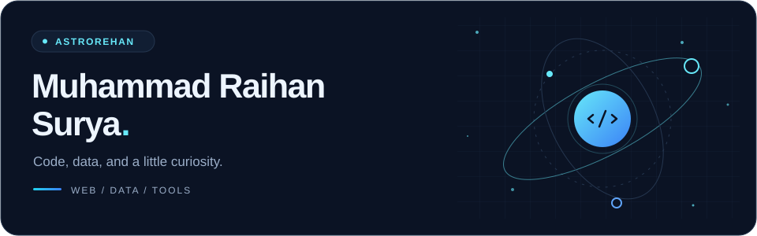
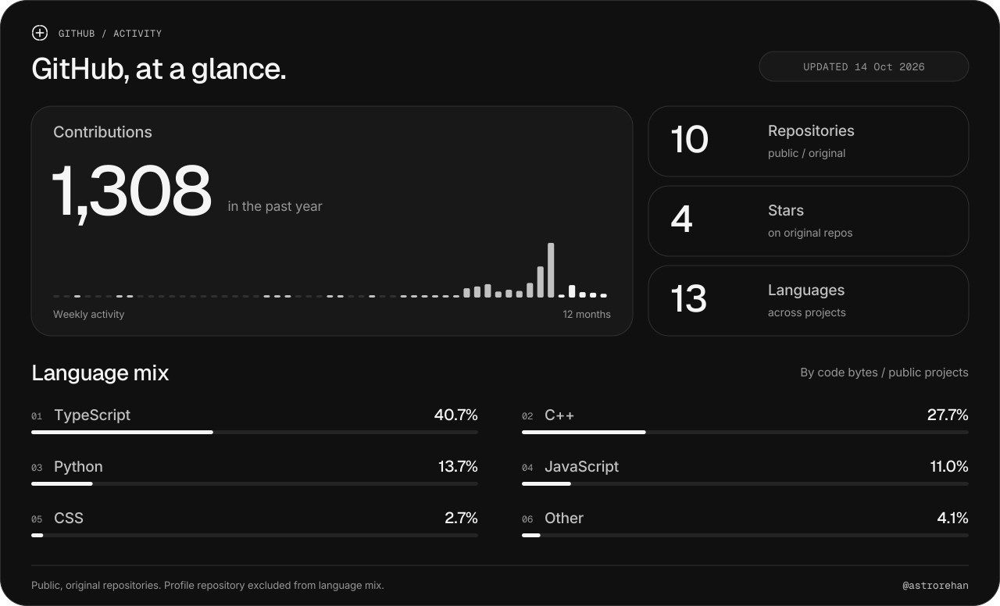

  <picture>
    <source media="(prefers-color-scheme: dark) and (max-width: 640px)" srcset="assets/header-dark-mobile.svg" />
    <source media="(prefers-color-scheme: light) and (max-width: 640px)" srcset="assets/header-light-mobile.svg" />
    <source media="(prefers-color-scheme: dark)" srcset="assets/header-dark.svg" />
    <source media="(prefers-color-scheme: light)" srcset="assets/header-light.svg" />
    
  </picture>

  <h1>Hi, I'm Raihan 👋</h1>
  
<b>IT student at Universitas Gadjah Mada · Indonesia</b>

  
I build web applications, explore data and machine learning, and make tools that connect ideas to useful experiences.

  
  
  

 

## 🧭 What I work on

- **Web applications** — interfaces, APIs, authentication, and dashboards.
- **Data & machine learning** — climate, agriculture, health, and geospatial applications.
- **Developer tools** — Figma-to-Roblox workflows with TypeScript and Luau.
- **Computer science fundamentals** — algorithms and data structures in C++.

## 💻 Tech stack

Technologies used across my public projects.

**Languages**

**Web & APIs**

**Data & ML**

**Tools & platforms**

## 🚀 Selected projects

| Project | What it does | Built with |
| :--- | :--- | :--- |
| **[Figlo](https://github.com/astrorehan/figlo)** | Imports Figma designs into Roblox Studio as editable UI. Currently in alpha. | TypeScript · Luau · Bun |
| **[PRAKIRA](https://github.com/astrorehan/prakira)** | Climate-based disease risk forecasts and early warning dashboards for Semarang. | Next.js · Express · FastAPI · PostgreSQL · XGBoost |
| **[PetaSurya](https://github.com/astrorehan/PetaSurya)** | Maps rooftop solar potential in Indonesia, with building-level energy and savings estimates. | Next.js · React · FastAPI · MapLibre · ONNX |
| **[PanenCerdas](https://github.com/astrorehan/panen-cerdas)** | Harvest predictions using satellite vegetation, weather, and agricultural data. | Next.js · FastAPI · scikit-learn · Supabase |
| **[agent-council](https://github.com/astrorehan/agent-council)** | Four-role adversarial decision protocol (Believer, Skeptic, Investor, Judge) with evidence-tier rulings. | Agent Skills · Claude Code · Codex · Gemini CLI |

[Browse all repositories →](https://github.com/astrorehan?tab=repositories)

<picture>
  <source media="(prefers-color-scheme: dark) and (max-width: 640px)" srcset="assets/stats-dark-mobile.svg" />
  <source media="(prefers-color-scheme: light) and (max-width: 640px)" srcset="assets/stats-light-mobile.svg" />
  <source media="(prefers-color-scheme: dark)" srcset="assets/stats-dark.svg" />
  <source media="(prefers-color-scheme: light)" srcset="assets/stats-light.svg" />
  
</picture>

Updated daily. Repository and language metrics use public, original repositories; language share measures code bytes, not proficiency. Contributions follow GitHub's profile visibility settings.

## 🐍 Contribution trail

<picture>
  <source media="(prefers-color-scheme: dark)" srcset="assets/snake-dark.svg" />
  <source media="(prefers-color-scheme: light)" srcset="assets/snake-light.svg" />
  
</picture>

---

  Curious by default. Learning by building.

